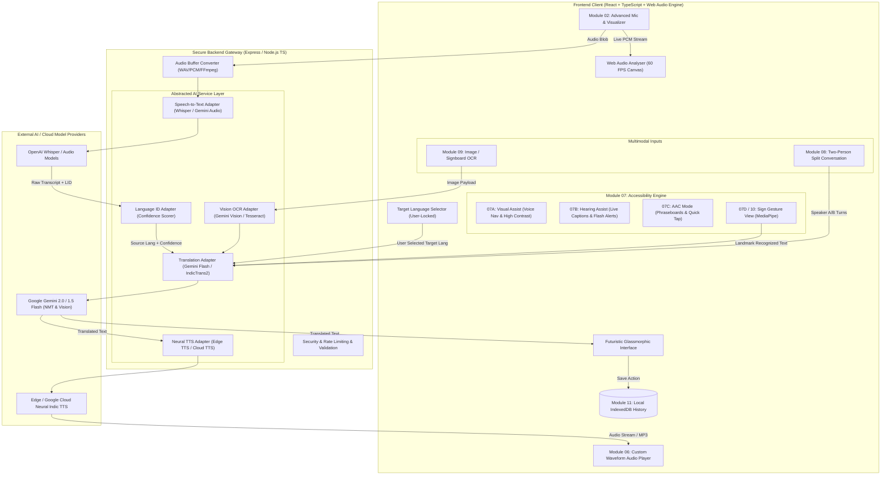
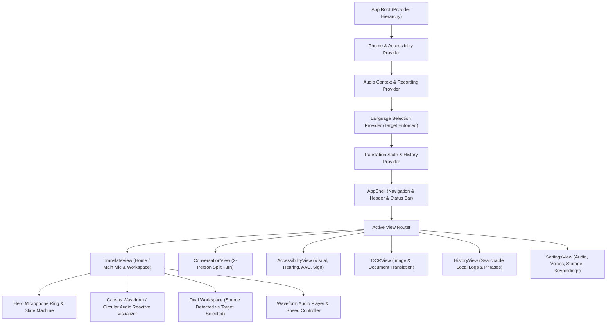
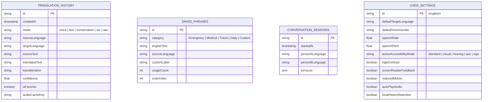
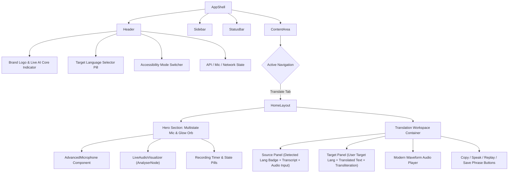
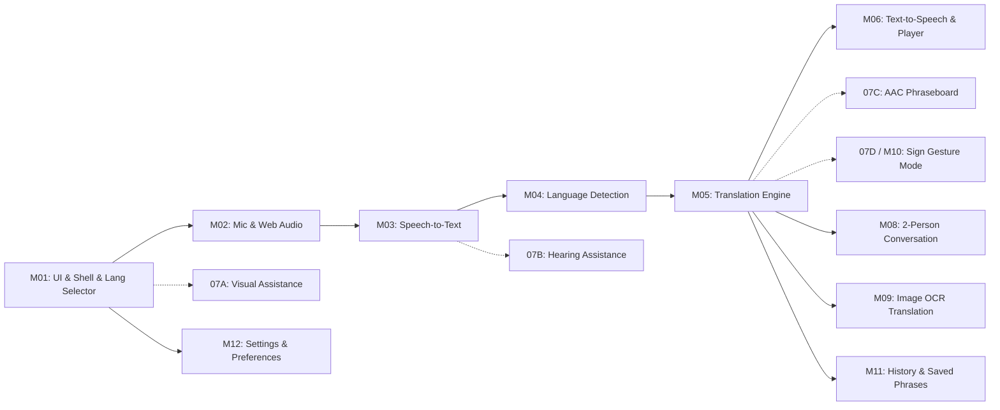
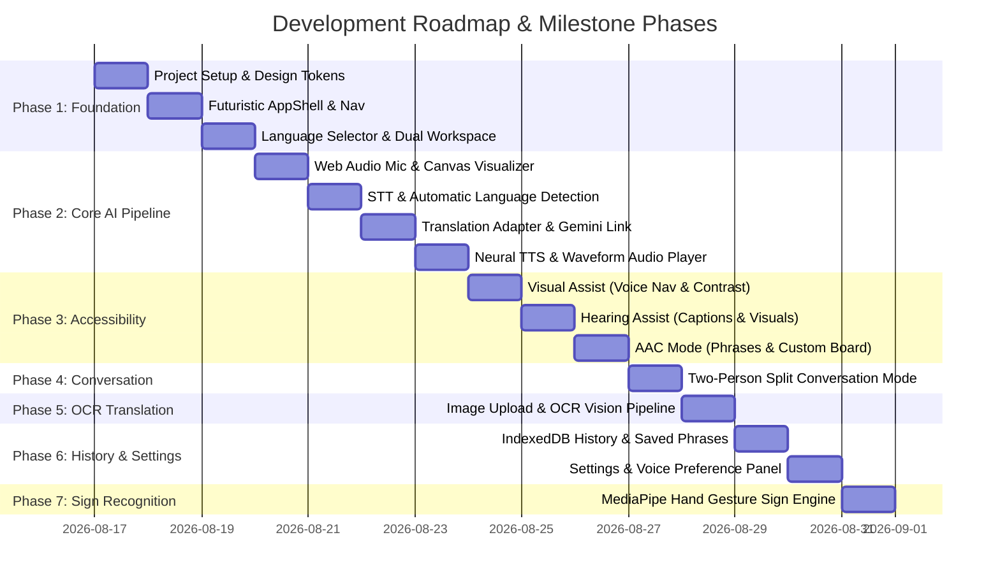

# Architectural Specification & Implementation Plan: AI-Powered Inclusive Multilingual Speech-to-Speech Translation System

**Academic Project Specification & Review Document**  
*Final-Year Capstone Project*

---

## Executive Summary

The **AI-Powered Inclusive Multilingual Speech-to-Speech Translation System** is a next-generation assistive communication platform designed to dismantle language barriers and accessibility challenges. Built on a human-centric, dark-first, futuristic glassmorphic design system, the application ingests multimodal inputs (Speech, Text, Sign Language Gestures, and Document/Signboard Images), performs **automatic source language detection (LID)**, translates accurately into a **user-selected target language**, and synthesizes natural **neural speech output** with real-time waveform visualization.

Accessibility is a foundational pillar: the system incorporates dedicated modes for **Visual Assistance (07A)**, **Hearing Assistance (07B)**, **Alternative & Augmentative Communication / AAC (07C)**, and **Sign Communication (07D)**.

---

## 1. Recommended Technology Stack

| Layer | Recommended Technology | Technical Rationale & Academic Justification |
| :--- | :--- | :--- |
| **Frontend Framework** | **React 18 / 19 + TypeScript + Vite** | Blazing-fast HMR, strict type safety for complex audio/AI state models, component reusability, and minimal bundle overhead. |
| **Design System & Styling** | **Modern CSS Modules + Design Tokens (CSS Variables)** | Complete styling control, zero runtime overhead, strictly adheres to custom futuristic glassmorphic UI without generic framework bloat. Full support for `@container` queries, CSS grid, backdrop blur, custom scrollbars, and `prefers-reduced-motion`. |
| **Icons & Micro-interactions** | **Lucide React + Motion/Web Animations API** | Ultra-crisp lightweight icons, fluid GPU-accelerated micro-interactions (magnetic hovers, pulse glows, smooth transitions). |
| **Browser Audio Engine** | **Web Audio API (`AudioContext`, `AnalyserNode`) + `MediaRecorder` API** | High-fidelity 60fps real-time frequency/waveform visualization, direct PCM/WAV buffer processing, low-latency audio capture and playback. |
| **Backend Runtime** | **Node.js (v20+ LTS) + Express + TypeScript** *(or Python FastAPI option)* | Single-language TS ecosystem between client and server, non-blocking I/O ideal for streaming audio buffers, robust ecosystem for AI SDK integrations. |
| **AI / Speech-to-Text (STT)** | **Hybrid Architecture**: OpenAI Whisper API / Gemini Multimodal Audio API + Web Speech API fallback | Whisper/Gemini models deliver state-of-the-art transcription for Indic languages (Tamil, Telugu, Hindi, Malayalam, Kannada, Bengali). Fallback to browser `webkitSpeechRecognition` guarantees zero-cost offline/dev resilience. |
| **AI / Language Detection (LID)** | **Multi-tier LID Engine**: Audio-level Whisper LID + Text-level Franc/FastText/Gemini NLU | Automatic source language identification with confidence scoring. Source language is never assumed; user target language is strictly preserved. |
| **AI / Translation (NMT)** | **Abstracted Translation Service (Google Gemini Flash / DeepL / LibreTranslate / IndicTrans2 adapter)** | Neural machine translation with contextual nuance preservation for regional dialects and idioms. Provider-agnostic adapter interface allows swapping backends without modifying client code. |
| **AI / Text-to-Speech (TTS)** | **Hybrid Neural TTS**: Microsoft Edge TTS / Google Cloud TTS / ElevenLabs + Web Speech `SpeechSynthesis` | High naturalness Indic speech generation with selectable accents/genders. Returns standard audio stream/blobs with full playback control and client fallback. |
| **Computer Vision (OCR & Sign)** | **Tesseract.js / Gemini Vision API** (OCR) + **MediaPipe Hands** (Sign recognition) | OCR extracts multi-lingual text from uploaded/camera images. MediaPipe Hand landmarks enable client-side gesture recognition for basic emergency sign phrases without server roundtrips. |
| **Client Storage & Privacy** | **IndexedDB (via Dexie.js) + LocalStorage** | Zero server-side hoarding of personal audio. Full client-side persistence for translation history, saved custom phraseboards, accessibility preferences, and offline cache. |

---

## 2. End-to-End System Architecture



---

## 3. Frontend Architecture



### Core Design System & Tokens:
* **Color Palette**: Dark-first deep space obsidian (`#0a0d14`, `#111622`), glass panel tints (`rgba(18, 24, 38, 0.7)`), cyan neon accent (`#00f2fe` to `#4facfe`), violet intelligence aura (`#7f00ff` to `#e100ff`), crisp emerald success (`#00f5a0`), warning amber (`#ffb703`), danger coral (`#ff4b4b`).
* **Glassmorphism**: Multi-layered backdrop blur (`backdrop-filter: blur(16px)`), subtle 1px border gradient highlights (`border: 1px solid rgba(255, 255, 255, 0.08)`), radial ambient glows.
* **Typography**: Modern font stack (`Outfit` / `Inter` / `Plus Jakarta Sans`) with dedicated Indic font fallback rendering (`Noto Sans Tamil`, `Noto Sans Devanagari`, `Noto Sans Telugu`, `Noto Sans Bengali`).

---

## 4. Backend Architecture

* **Modular Clean Architecture**:
  * **Controller Layer**: Handles HTTP requests, parameter validation, rate limiting, and response formatting.
  * **Service Adapter Layer**: Abstract interfaces (`ITranslationService`, `ISpeechToTextService`, `ITextToSpeechService`, `IOCRService`) decoupled from concrete vendor implementations.
  * **Provider Implementations**:
    * `GeminiTranslationProvider` (implements `ITranslationService`)
    * `WhisperSTTProvider` & `GeminiAudioSTTProvider` (implement `ISpeechToTextService`)
    * `EdgeNeuralTTSProvider` (implements `ITextToSpeechService`)
    * `GeminiVisionOCRProvider` (implements `IOCRService`)
  * **Fallback Orchestrator**: Automatically cascades to secondary providers or browser-native fallbacks if primary API quota or network errors occur.
  * **Security**: Strict CORS policies, zero API key exposure to browser, audio buffers processed in-memory without persistent disk writes unless explicitly requested.

---

## 5. AI & Multilingual Translation Architecture

### Initial Supported Language Matrix:

| Language | ISO Code | Script / Native Name | Speech-to-Text Support | Neural TTS Voice Sample |
| :--- | :--- | :--- | :--- | :--- |
| **English** | `en` | English | Whisper / Gemini / Web Speech | `en-US-JennyNeural` / `en-IN-NeerjaNeural` |
| **Tamil** | `ta` | தமிழ் | Whisper / Gemini / Web Speech | `ta-IN-PallaviNeural` / `ta-IN-ValluvarNeural` |
| **Hindi** | `hi` | हिन्दी | Whisper / Gemini / Web Speech | `hi-IN-SwaraNeural` / `hi-IN-MadhurNeural` |
| **Telugu** | `te` | తెలుగు | Whisper / Gemini / Web Speech | `te-IN-ShrutiNeural` / `te-IN-MohanNeural` |
| **Malayalam** | `ml` | മലയാളം | Whisper / Gemini / Web Speech | `ml-IN-SobhanaNeural` / `ml-IN-MidhunNeural` |
| **Kannada** | `kn` | ಕನ್ನಡ | Whisper / Gemini / Web Speech | `kn-IN-SapnaNeural` / `kn-IN-GaganNeural` |
| **Bengali** | `bn` | বাংলা | Whisper / Gemini / Web Speech | `bn-IN-TanishaaNeural` / `bn-IN-BashkarNeural` |

### Pipeline Logic:
1. **Audio Ingestion**: Audio recorded at 16kHz/48kHz PCM via `MediaRecorder` or Web Audio buffer.
2. **Speech-to-Text & Automatic LID**:
   * Speech audio is passed to backend STT engine.
   * Model outputs `{ transcript: string, detectedLanguage: string, confidence: number }`.
   * If confidence is below threshold (< 0.65), prompt displays "Detected: [Language] (Uncertain) - Click to adjust".
3. **Context-Aware Translation**:
   * Translation request contains `sourceLanguage`, `targetLanguage`, and `text`.
   * Gemini / NMT engine receives specialized system instructions prioritizing natural regional conversational idioms over stiff word-by-word substitutions.
   * Phonetic transliteration (e.g. English script for Tamil words) is optionally provided for accessibility.
4. **Text-to-Speech Synthesis**:
   * Translated text is dispatched to TTS synthesizer with selected target language code.
   * Synthesizer produces audio stream (MP3/WAV) + word timestamps if available.
   * Client-side Web Audio API renders waveform visualization during playback.

---

## 6. Database & Storage Design

To maintain strict user privacy and zero server maintenance overhead, data persistence follows a **Local-First Architecture** utilizing browser **IndexedDB**:



---

## 7. REST & Streaming API Design

All endpoints reside on `/api/v1/*` behind the Express backend:

### 1. `POST /api/v1/speech/transcribe`
* **Request**: `multipart/form-data` with `audio` file (blob/wav/webm) + optional `hints`.
* **Response**:
  ```json
  {
    "success": true,
    "transcript": "நீங்கள் எப்படி இருக்கிறீர்கள்?",
    "detectedLanguage": "ta",
    "languageName": "Tamil",
    "confidence": 0.96,
    "durationMs": 2400
  }
  ```

### 2. `POST /api/v1/translate`
* **Request**:
  ```json
  {
    "text": "நீங்கள் எப்படி இருக்கிறீர்கள்?",
    "sourceLanguage": "ta",
    "targetLanguage": "en",
    "preserveFormatting": true
  }
  ```
* **Response**:
  ```json
  {
    "success": true,
    "sourceLanguage": "ta",
    "targetLanguage": "en",
    "translatedText": "How are you?",
    "transliteration": "Neengal eppadi irukkireergal?",
    "detectedLanguageName": "Tamil",
    "targetLanguageName": "English"
  }
  ```

### 3. `POST /api/v1/tts/synthesize`
* **Request**:
  ```json
  {
    "text": "How are you?",
    "language": "en",
    "voiceGender": "female",
    "speed": 1.0,
    "pitch": 1.0
  }
  ```
* **Response**: Binary Audio Stream (`audio/mpeg` or `audio/wav`) or Base64 data URI + duration metadata.

### 4. `POST /api/v1/ocr/extract-and-translate`
* **Request**: `multipart/form-data` with image file + `targetLanguage`.
* **Response**:
  ```json
  {
    "success": true,
    "extractedText": "அவசர சிகிச்சை பிரிவு",
    "detectedLanguage": "ta",
    "translatedText": "Emergency Care Unit",
    "boundingBoxes": []
  }
  ```

### 5. `GET /api/v1/health` & `GET /api/v1/languages`
* System status, active AI provider connection health, and list of supported language codes and metadata.

---

## 8. Directory & Folder Structure

```
d:\AI Translator\
├── package.json
├── tsconfig.json
├── vite.config.ts
├── index.html
├── .env.example
│
├── src/                                  # Frontend Application
│   ├── main.tsx                          # App Entrypoint
│   ├── App.tsx                           # Root Provider Composition & Router
│   ├── index.css                         # Design System, Tokens, Keyframes, Resets
│   │
│   ├── assets/                           # Sound effects, icons, fallback assets
│   │
│   ├── components/                       # Modular UI Components
│   │   ├── common/                       # Buttons, Cards, Modals, Tooltips, Badges
│   │   │   ├── GlassCard.tsx
│   │   │   ├── FuturisticButton.tsx
│   │   │   ├── StatusBadge.tsx
│   │   │   └── Toast.tsx
│   │   ├── layout/                       # AppShell, Sidebar, Header, MobileNav
│   │   │   ├── AppShell.tsx
│   │   │   ├── Header.tsx
│   │   │   ├── Sidebar.tsx
│   │   │   └── StatusBar.tsx
│   │   ├── speech/                       # Mic, Waveform, Audio Controls
│   │   │   ├── AdvancedMicrophone.tsx    # Multi-state central hero mic
│   │   │   ├── LiveAudioVisualizer.tsx   # Canvas 60fps waveform
│   │   │   ├── WaveformAudioPlayer.tsx   # Neural audio output player
│   │   │   └── AudioRecordTimer.tsx
│   │   ├── translation/                  # Language selector, dual workspace
│   │   │   ├── TargetLanguageSelector.tsx
│   │   │   ├── DetectedLanguageBadge.tsx
│   │   │   ├── TranslationWorkspace.tsx
│   │   │   ├── TranscriptionPanel.tsx
│   │   │   └── ActionToolbar.tsx
│   │   ├── conversation/                 # Two-person split dialogue
│   │   │   ├── ConversationWorkspace.tsx
│   │   │   ├── SpeakerTurnCard.tsx
│   │   │   └── ConversationTranscript.tsx
│   │   ├── accessibility/                # Dedicated A11y Submodules
│   │   │   ├── VisualAssistanceDock.tsx  # High-contrast, large text, screen-reader
│   │   │   ├── HearingAssistancePanel.tsx# Live captioning, visual audio flash
│   │   │   ├── AACPhraseBoard.tsx        # Quick communication grid & custom phrases
│   │   │   └── SignLanguageView.tsx      # MediaPipe camera gesture interface
│   │   ├── ocr/                          # OCR Upload & Camera
│   │   │   ├── ImageUploader.tsx
│   │   │   └── OCRResultViewer.tsx
│   │   └── history/                      # Saved phrases and session search
│   │       ├── HistoryTable.tsx
│   │       └── SavedPhrasesList.tsx
│   │
│   ├── contexts/                         # React Contexts / State Managers
│   │   ├── AudioContext.tsx
│   │   ├── TranslationContext.tsx
│   │   ├── AccessibilityContext.tsx
│   │   └── ThemeContext.tsx
│   │
│   ├── hooks/                            # Custom React Hooks
│   │   ├── useAudioRecorder.ts
│   │   ├── useAudioVisualizer.ts
│   │   ├── useSpeechRecognition.ts
│   │   ├── useSpeechSynthesis.ts
│   │   ├── useMediaPipeHands.ts
│   │   └── useKeyboardShortcuts.ts
│   │
│   ├── services/                         # API Client Services
│   │   ├── api.ts                        # Axios/Fetch wrapper
│   │   ├── speechService.ts
│   │   ├── translationService.ts
│   │   ├── ocrService.ts
│   │   ├── db.ts                         # IndexedDB Dexie database
│   │   └── phrasesData.ts                # Default AAC emergency & medical phrases
│   │
│   ├── types/                            # TypeScript Type Definitions
│   │   ├── speech.types.ts
│   │   ├── translation.types.ts
│   │   ├── accessibility.types.ts
│   │   └── history.types.ts
│   │
│   └── utils/                            # Helper utilities
│       ├── audioHelpers.ts
│       ├── languageHelpers.ts
│       └── a11yHelpers.ts
│
└── server/                               # Backend Server Engine
    ├── index.ts                          # Express Server Entrypoint
    ├── config/                           # Environment & AI Provider Configs
    │   └── env.config.ts
    ├── controllers/                      # Request Handlers
    │   ├── speech.controller.ts
    │   ├── translation.controller.ts
    │   ├── tts.controller.ts
    │   └── ocr.controller.ts
    ├── routes/                           # API Routes
    │   └── api.routes.ts
    ├── services/                         # Abstracted Business Logic & AI Adapters
    │   ├── stt/
    │   │   ├── stt.interface.ts
    │   │   ├── whisper.provider.ts
    │   │   └── gemini-audio.provider.ts
    │   ├── translation/
    │   │   ├── translation.interface.ts
    │   │   └── gemini-nmt.provider.ts
    │   ├── tts/
    │   │   ├── tts.interface.ts
    │   │   └── edge-tts.provider.ts
    │   └── ocr/
    │       ├── ocr.interface.ts
    │       └── vision-ocr.provider.ts
    └── utils/
        └── audioConverter.ts
```

---

## 9. Component Structure & Hierarchy



---

## 10. Module Dependencies & Execution Flow



> [!IMPORTANT]
> **Non-blocking Architecture**: Module 07D / 10 (Sign Recognition) and Module 09 (OCR) are decoupled from the Core Translation Engine. The Core MVP (M01 → M06 + M07A/B/C) will be established, validated, and tested before mounting OCR and Vision modules.

---

## 11. MVP (Minimum Viable Product) Definition

The MVP strictly fulfills the primary system workflow:
1. **Target Language Selection**: Intuitive user picker for 7 initial languages (Tamil, Hindi, Telugu, Malayalam, Kannada, Bengali, English). Target language is locked by the user and never mutated by detection.
2. **Microphone Interaction**: Interactive multi-state animated microphone (IDLE, LISTENING, PROCESSING, TRANSLATING, COMPLETE, ERROR).
3. **Web Audio Visualizer**: 60fps real-time waveform reacting to microphone frequency data.
4. **Speech-to-Text**: Ingestion of spoken Indic/English speech with live or final transcription.
5. **Automatic Source Language Detection**: Accurate detection badge with confidence level.
6. **Translation Engine**: Nuance-preserving translation into the user-selected target language.
7. **Translated Text Display**: Rich dual-panel workspace with transliteration and quick actions (Copy, Replay, Edit).
8. **Neural Text-to-Speech**: Instant speech synthesis in target language.
9. **Custom Audio Player**: Dedicated player with playback progress, waveform, speed options, and replay.
10. **Core Accessibility**: Semantic ARIA landmarks, keyboard navigation (`Space` to record, `Ctrl+Enter` to translate), high-contrast toggle, screen reader alerts, and initial AAC Emergency Phraseboard.

---

## 12. Development Phases



---

## 13. Testing Strategy

1. **Unit & Integration Tests**:
   * Component rendering and state transitions across all 6 mic states.
   * Translation adapter mocks validating Indic character encodings and fallback mechanisms.
   * IndexedDB CRUD operations for history and custom phrases.
2. **Audio & Media Stream Tests**:
   * Browser microphone permission grant/deny state handling.
   * `AudioContext` suspension and resume behaviors on mobile browsers.
   * Audio player buffer decoding and edge-case empty audio streams.
3. **Accessibility Audits (a11y)**:
   * Automated axe-core / Lighthouse testing targeting 100% WCAG 2.1 AA compliance.
   * Keyboard-only full navigation run-through (Tab index, Enter, Escape, Spacebar).
   * Screen reader compatibility (NVDA / VoiceOver) using semantic ARIA Live Regions (`aria-live="polite"` for transcriptions and translated text).
4. **Academic Demonstration & Viva Readiness**:
   * Pre-configured test scenarios (e.g., Tamil speaker requesting hospital directions → English translation and speech).
   * Clear error boundary screens and offline fallback simulations.

---

## 14. Security & Privacy Considerations

* **API Key Isolation**: Gemini and third-party AI keys reside strictly in the backend `.env` file and are never passed to the client bundle.
* **Audio Buffer Lifecycle**: Audio recorded from the microphone is streamed/sent directly to the processing adapter and immediately dereferenced in memory after STT synthesis. No audio surveillance or permanent voice recordings stored without explicit user consent.
* **Local-First History**: Translation history is stored inside the user's browser IndexedDB. Users have one-click "Clear All Data" and "Export Data" controls in Settings.
* **Input Sanitization**: Text and OCR outputs are sanitized to prevent XSS attacks before DOM insertion.

---

## 15. Accessibility Strategy (WCAG 2.1 Compliance)

```mermaid
graph TD
    A11yRoot["Comprehensive Accessibility Architecture"]
    
    A11yRoot --> V["07A: Visual Assistance"]
    V --> V1["High Contrast Themes (4.5:1 to 7:1 ratio)"]
    V --> V2["Scalable Typography (Rem-based, Large Text mode)"]
    V --> V3["Auto Speech Output upon Translation"]
    V --> V4["Audio Feedback Cues on State Changes"]

    A11yRoot --> H["07B: Hearing Assistance"]
    H --> H1["Live Real-time Captions & High-visibility Subtitles"]
    H --> H2["Visual Audio Waveform & Pulse Beacon"]
    H --> H3["Flash/Glow on Translation Complete"]

    A11yRoot --> AACMode["07C: Alternative Communication (AAC)"]
    AACMode --> AAC1["Emergency Phraseboard (One-touch speech)"]
    AACMode --> AAC2["Categorized Grid (Medical, Food, Assistance, Travel)"]
    AACMode --> AAC3["Custom Quick Phrase Builder"]

    A11yRoot --> Sign["07D: Sign Communication Mode"]
    Sign --> Sign1["MediaPipe Real-Time Hand Landmark Tracking"]
    Sign --> Sign2["Gesture Classification to Text & Instant TTS"]
```



---

## 16. Deployment Strategy

* **Local Development**: Unified run script (`npm run dev`) launching Vite on `http://localhost:5173` and Express API backend on `http://localhost:5000` with automated proxying.
* **Production Packaging**: Vite builds optimized static assets to `dist/`, served by the Express backend with compression and security headers (`Helmet`).
* **Containerization**: Optional `Dockerfile` for single-command deployment to Docker, Render, Cloud Run, or Railway.
* **Zero-Install Viva Demo Mode**: Embedded client-side mock/fallback mode capable of running offline or with zero API credit depletion during project defense.

---

## 17. Potential Technical Risks & Mitigations

| Identified Risk | Impact | Architectural Mitigation Strategy |
| :--- | :--- | :--- |
| **Browser Microphone Permissions Blocked** | High | Graceful fallback banner with instructions, automatic activation of Text Input / AAC Mode so the app remains 100% usable without mic. |
| **Third-Party AI API Latency / Quota Exhaustion** | High | Multi-tier fallback architecture: Primary Gemini Flash → Secondary Cloud Endpoint → Client-side Web Speech API fallback. |
| **Indic Regional Dialect Translation Loss** | Medium | Custom prompt engineering with explicit regional idiom preserving instructions and phonetic transliteration generation. |
| **Mobile Browser AudioContext Suspension** | Medium | Explicit user gesture event listener (`touchstart`/`click`) unlocking Web Audio context on mobile browsers. |
| **Heavy Client-Side OCR / Sign Processing** | Medium | MediaPipe runs on dedicated lightweight WebGL/WASM threads; OCR is processed server-side or via optimized Tesseract worker. |

---

## 18. Estimated Implementation Order

1. **Step 1: Project Initialization & Design System** (Vite + React + TS + Express + Glassmorphic CSS Design System).
2. **Step 2: App Shell, Navigation & Target Language Selector** (Header, Sidebar, Status Bar, Locked Target Picker).
3. **Step 3: Advanced Microphone & Canvas Audio Visualizer** (Web Audio API, 60fps waveform, 6 mic state machines).
4. **Step 4: Speech-to-Text & Automatic Language Detection Integration** (Backend STT adapter, Whisper/Gemini audio pipeline, confidence display).
5. **Step 5: Contextual Translation Engine & Dual Workspace** (Indic NMT adapter, transliteration, dual workspace card).
6. **Step 6: Neural Text-to-Speech & Waveform Audio Player** (Edge TTS / Cloud TTS integration, custom waveform playback controller).
7. **Step 7: Accessibility Modules (07A Visual, 07B Hearing, 07C AAC Phraseboard)**.
8. **Step 8: Module 08 — Two-Person Real-Time Split Conversation Mode**.
9. **Step 9: Module 09 — Image & Signboard OCR Translation**.
10. **Step 10: Module 11 & 12 — IndexedDB History, Saved Phrases, and Settings**.
11. **Step 11: Module 10 — MediaPipe Sign Language Recognition**.
12. **Step 12: Comprehensive Testing, a11y Audits, and Final Viva Documentation**.

---

## Verification Plan

### Automated Verification:
- Build check: `npm run build` (zero TypeScript or bundle errors).
- Server test: `npm test` or automated endpoint checks for `/api/v1/translate`, `/api/v1/speech/transcribe`, `/api/v1/tts/synthesize`.

### Manual & Interactive Verification:
- Audio recording with live visualizer waveform response.
- Spoken Tamil/Hindi/Telugu/English input → Automatic language detection badge → Accurate English/Indic translation → Neural audio playback.
- Verification that user-selected target language is NEVER overridden.
- Accessibility keyboard navigation and AAC phraseboard audio synthesis.
- 2-Person conversation turn-taking validation.
- OCR translation of sample signboards and notices.

---

## User Review Required

> [!IMPORTANT]
> Please review this comprehensive architecture and implementation plan. Once approved, Phase 1 (Project Setup, Design System, App Shell, and Target Language Workspace) will begin immediately.
